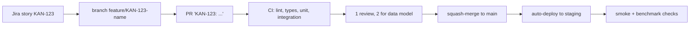

# Deployment

## Environments

| Environment | What runs | When |
|---|---|---|
| Local | Docker Compose for PostgreSQL, Redis, MinIO; API, worker and web on the host | From Sprint 1 |
| Staging | Containerized web, API and worker; PostgreSQL and Redis; Caddy for TLS; separate keys | From Sprint 7 (KAN-113) |
| Release candidate | Tagged build on staging with runbook and tested rollback | 26 Feb 2027 (KAN-136) |

## Pipeline

## Secrets

- API keys hashed with argon2 and shown once.
- Provider secrets encrypted at rest (Fernet, master key from the environment) and never returned.
- Staging uses its own keys. Nothing secret is committed.

## Documentation site

This site is built with MkDocs Material and published to GitHub Pages by `.github/workflows/docs.yml` on every push to `main` that touches `docs/` or `mkdocs.yml`.

One-time setup: **Settings → Pages → Build and deployment → Source: GitHub Actions**.

## Runbook

The staging runbook (deploy, rollback, rotate keys, restore database) is written in Sprint 7 and linked here.
