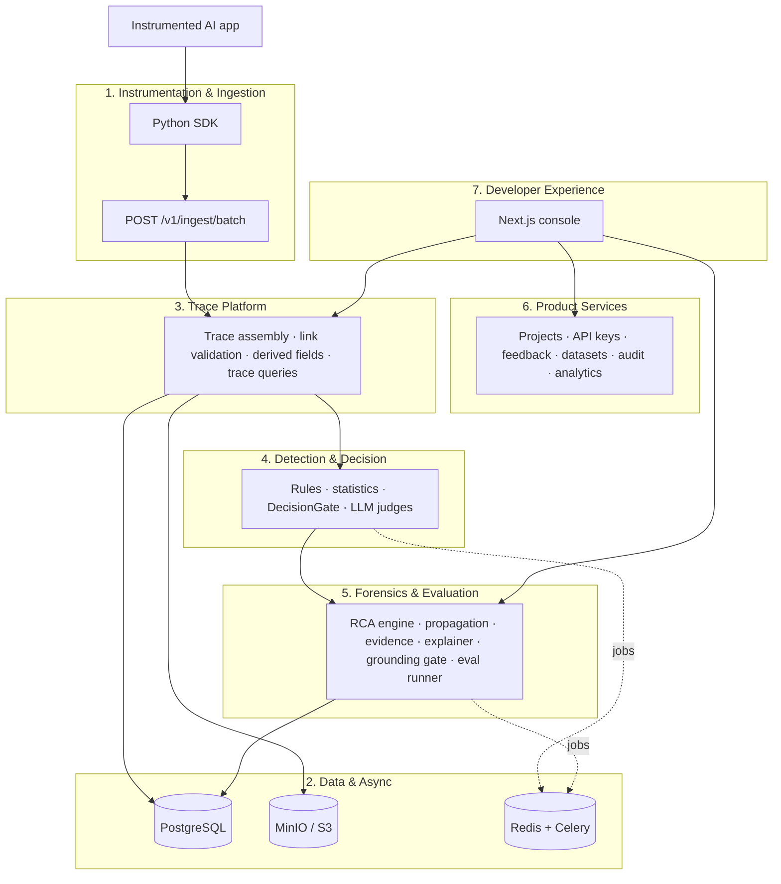

# Architecture

V1 is a **modular monolith with asynchronous workers**, not microservices. Deployment stays simple for a 7-person team while module boundaries stay strict: modules talk through typed interfaces even inside one FastAPI app.

## Seven layers



| Layer | Responsibility |
|---|---|
| 1. Instrumentation & Ingestion | SDK creates trace and span context and links, captures inputs and outputs, redacts secrets, sends batches to the authenticated ingestion API. |
| 2. Data & Async | PostgreSQL for metadata and relationships, MinIO/S3 for large payloads, Redis for the Celery queue, cache, rate limits and progress. |
| 3. Trace Platform | Assembles traces, validates parent/child and links, computes latency, tokens and cost, serves trace queries. |
| 4. Detection & Decision | Runs validators, statistics, DecisionGate and LLM judges. Outputs quality signals, not a diagnosis. |
| 5. Forensics & Evaluation | Localizes root cause, tracks propagation, ranks candidates, builds evidence, explains, grounds claims, runs regressions. |
| 6. Product Services | Projects, API keys, feedback, datasets, configuration, retention, audit log, analytics. |
| 7. Developer Experience | Console: overview, traces, failures, compare, evaluations, datasets, analytics, settings. |

## Technology stack

| Area | Choice |
|---|---|
| Language | Python 3.12 |
| Backend API | FastAPI, Pydantic v2 |
| Persistence | SQLAlchemy 2, Alembic, PostgreSQL 16 |
| Queue / cache | Redis 7, Celery |
| Object storage | MinIO locally, S3-compatible in staging |
| Tracing standard | OpenTelemetry concepts (IDs, span links, semantic attributes) |
| AI providers | OpenAI first, Anthropic optional, behind a provider adapter |
| Decision gate | DecisionGate interface: Jev backend if available, structured-output LLM classifier fallback |
| Frontend | Next.js, React, TypeScript, Tailwind CSS, React Flow, Recharts |
| Testing | pytest, Testcontainers, Vitest, React Testing Library, Playwright |
| Quality | Ruff (lint and format), mypy, ESLint, Prettier, TypeScript strict |
| CI/CD | GitHub Actions |
| Packaging | Docker, Docker Compose, Caddy (TLS) |
| Project management | Jira (`KAN`), Confluence (`FF`), GitHub for Jira |

## Root-cause algorithm (V1)

1. Validate trace structure and record explicit operational errors.
2. Collect quality signals for every span.
3. Build the **data-flow graph** from span links (fallback: parent/child plus sibling order, at lower confidence).
4. Walk backward from the failed output along data-flow edges.
5. Estimate quality change between each span's inputs and its output.
6. Mark the earliest span where significant degradation is introduced as `root_cause`.
7. Label downstream spans on the path `propagated` or `degraded`.
8. Rank alternative candidates (score = severity × confidence × earliness).
9. Generate an explanation that cites only stored evidence IDs.
10. Run the grounding gate; remove or flag unsupported claims.
11. Return root cause, family, category, confidence, evidence, path and span roles.

### Example

| Span | Role | What happened |
|---|---|---|
| Retriever | <span class="role-healthy">healthy</span> | Correct document found at rank 2 |
| Reranker | <span class="role-root">root_cause</span> | Correct document moved from rank 2 to rank 8 |
| Context builder | <span class="role-prop">propagated</span> | Top-5 cutoff removed the correct document |
| Generator | <span class="role-prop">degraded</span> | Answered without the ground-truth evidence |
| Final answer | <span class="role-root">failed_output</span> | Wrong answer returned |

## Failure taxonomy

| Family | Categories |
|---|---|
| MODEL | HALLUCINATION, INSTRUCTION_FAILURE, FORMAT_FAILURE, REASONING_FAILURE, REFUSAL_ERROR, CONFIDENCE_MISMATCH |
| RETRIEVAL | RETRIEVAL_MISS, IRRELEVANT_RETRIEVAL, RERANKING_FAILURE, CONTEXT_POLLUTION, CONTEXT_OVERFLOW, CITATION_FAILURE |
| AGENT_TOOL | PLANNING_FAILURE, TOOL_SELECTION_FAILURE, TOOL_ARGUMENT_FAILURE, TOOL_EXECUTION_FAILURE, LOOP_FAILURE, PREMATURE_TERMINATION |
| PIPELINE | CONTEXT_LOSS, SCHEMA_FAILURE, DEPENDENCY_FAILURE, TIMEOUT |
| CONFIGURATION | PROMPT_REGRESSION, MODEL_REGRESSION, PARAMETER_REGRESSION, TOKEN_LIMIT_FAILURE |
| PLATFORM | INGESTION_FAILURE, STORAGE_FAILURE, EVALUATOR_FAILURE, QUEUE_FAILURE, PROVIDER_OUTAGE |

## Repository layout

```text
failure-forensics/
├── backend/app/{api,auth,ingestion,tracing,detection/{rules,statistics,decision_gate,judges},
│                forensics,evidence,evaluation,experiments,analytics,storage,workers,config}
├── backend/{migrations,tests}
├── sdk/python/
├── frontend/
├── benchmarks/{document_pipeline,rag_app,agent_app}
├── datasets/
├── docs/            ← this site
├── infra/  scripts/  .github/workflows/
├── docker-compose.yml
└── mkdocs.yml
```
