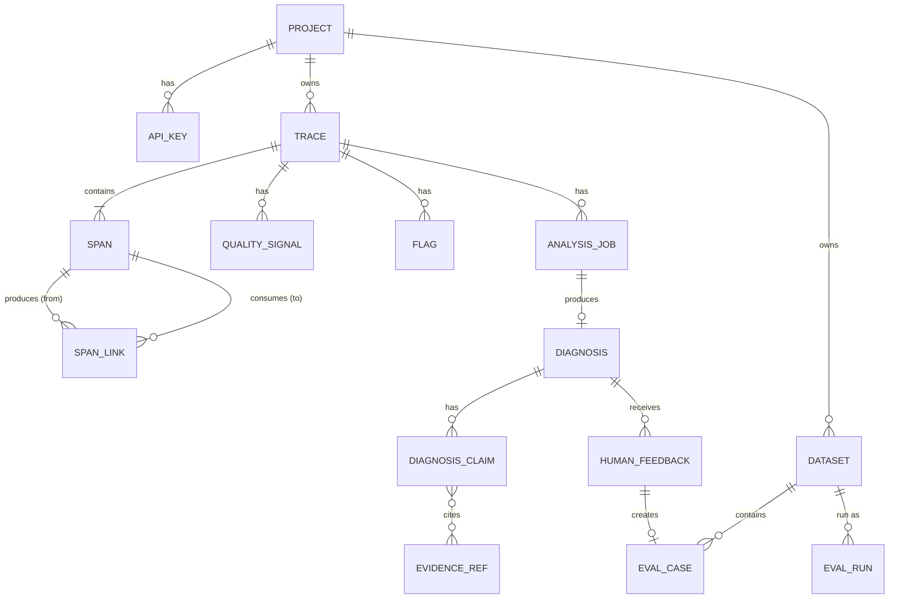

# Data Model

## Entity relationships



## Core schemas

=== "Trace"
    ```text
    id, project_id, external_trace_id?
    started_at, ended_at
    status: ok | error | incomplete            (operational)
    health: healthy | degraded | failed | unknown   (from detection)
    root_span_id, total_latency_ms
    total_input_tokens, total_output_tokens
    estimated_cost_usd: Decimal(12,6)
    pipeline_version, git_commit?, tags (JSONB)
    feedback_status: none | flagged | reviewed
    ```

=== "Span / SpanLink"
    ```text
    Span
    id, trace_id, parent_span_id?, name
    component_key        e.g. "rag.reranker" (stable across runs)
    type: llm | retrieval | reranker | tool | agent | transform | guardrail | custom
    started_at, ended_at, latency_ms
    status: ok | error | timeout | cancelled
    input_ref, output_ref, prompt_ref, raw_response_ref
    model_provider, model_name, prompt_version, component_version
    input_tokens, output_tokens, estimated_cost_usd
    error_type, error_message, attributes (JSONB)

    SpanLink
    from_span_id (producer), to_span_id (consumer)
    relation: consumes_output_of | retries | follows
    ```

=== "QualitySignal"
    ```text
    id, trace_id, span_id? (null for trace-level signals)
    detector_type: rule | statistic | decision_gate | llm_judge | user_flag
    check_name, verdict: pass | fail | review | unknown
    score, confidence (0..1)
    failure_family?, failure_category?   (from taxonomy.py)
    evidence_ids[], evaluator_version, created_at
    ```

=== "Diagnosis"
    ```text
    Diagnosis
    id, trace_id, analysis_job_id
    root_cause_span_id, root_cause_component_key
    candidate_causes [{span_id, score, rationale}]
    failure_family, failure_category, confidence
    explanation, explanation_pre_gate
    propagation_path [span_id]
    span_roles {span_id: healthy | root_cause | propagated | degraded | failed_output | unknown}
    grounded, human_status: unreviewed | confirmed | corrected | unsure
    explainer_model, analysis_version, created_at

    DiagnosisClaim
    id, diagnosis_id, text, evidence_ids[]
    status: supported | inference | unsupported_removed

    EvidenceRef
    id, trace_id, span_id?
    source_type: span_input | span_output | document | tool_response | quality_signal | rule_result | metadata
    field_path / object_ref, excerpt_or_summary, content_hash (sha256)
    ```

=== "EvalCase"
    ```text
    id, dataset_id, source_trace_id?
    input_fixture (object ref), expected_behavior
    expected_root_cause_component, expected_root_cause_span_type
    expected_failure_category, golden_output?, labels
    created_from: human_confirmed | injected_fault | curated | fixed_regression
    ```

=== "Supporting"
    ```text
    Project      : id, name, owner_user_id, capture_policy, retention_days
    ApiKey       : id, project_id, prefix, key_hash (argon2), created_at, revoked_at
    Flag         : id, trace_id, span_id?, reason, source (user|api|detector), created_by
    AnalysisJob  : id, kind, target_id, state (queued|running|succeeded|failed|cancelled),
                   progress, stage, error, attempts, timestamps
    HumanFeedback: id, diagnosis_id, reviewer_id, decision (confirm|correct|unsure),
                   corrected_span_id?, corrected_category?, note
    Dataset      : id, project_id, name, kind (golden|failure|injected), version
    EvalRun      : id, dataset_id, pipeline_version, baseline_run_id?, job_id,
                   pass_count, fail_count, metrics, recommendation
    AuditLog     : id, project_id, actor_id, action, target, before, after
    ```

## Fault-injection record

```text
InjectedFault
fault_id, workload (document | rag | agent), fault_type
target_component_key, injection_parameters (JSONB)
expected_root_cause_component, expected_failure_category
expected_downstream_impact [component_key]
random_seed, split (dev | heldout)
```

## API surface

| Method | Endpoint | Purpose | Tier |
|---|---|---|---|
| POST | `/v1/projects` | Create project | MVP |
| POST / DELETE | `/v1/projects/{id}/api-keys[/{key_id}]` | Create (shown once) or revoke key | MVP |
| POST | `/v1/ingest/batch` | Idempotent upsert of traces, spans, links | MVP |
| POST | `/v1/traces/{id}/complete` | Trigger assembly and detection | MVP |
| GET | `/v1/traces`, `/v1/traces/{id}` | List / detail | MVP |
| POST | `/v1/traces/{id}/flags` | Flag a bad output | MVP |
| POST | `/v1/traces/{id}/analyses` | Start forensic analysis job | MVP |
| GET | `/v1/jobs/{id}` | Job status and progress | MVP |
| GET | `/v1/diagnoses`, `/v1/diagnoses/{id}` | Failures list / diagnosis detail | MVP |
| POST | `/v1/diagnoses/{id}/feedback` | Confirm / correct / unsure | MVP |
| POST | `/v1/eval-cases` | Create eval case | MVP |
| GET, POST | `/v1/datasets` | List / create datasets | MVP |
| POST, GET | `/v1/eval-runs[/{id}]` | Regression run and results | Target |
| GET | `/v1/analytics/overview` | Dashboard metrics | Stretch |
| POST | `/v1/exports` | Export diagnoses / results | Stretch |
| POST | `/v1/experiments` | Comparison experiment | Stretch |
| GET | `/health`, `/ready` | Liveness / readiness | MVP |
