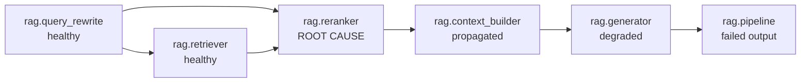

# Root-cause analysis design

| | |
|---|---|
| Status | Draft for review |
| Owner | T5 AI Forensics (Sashreek) |
| Reviewer | T1 (Pranav) |
| Jira | [KAN-28](https://pranav01.atlassian.net/browse/KAN-28) |
| GitHub | [#8](https://github.com/UndergraduateArtificialIntelligenceClub/Failure-Forensics/issues/8) |
| Covers | Blueprint v1.1 §10.1 |

!!! note "AI use"
    Drafted with Claude (Claude Code) from the blueprint notes in this repository and the FF Confluence space. The owner reviews it and is responsible for it before T1 review.

This page defines how the forensics engine picks the root cause of a failed trace, which spans it labels as propagated or degraded, and how sure it is. It is the design for RCA v0 ([KAN-59](https://pranav01.atlassian.net/browse/KAN-59)) and RCA v1 ([KAN-81](https://pranav01.atlassian.net/browse/KAN-81)). The fixture traces it is tested against live in `backend/tests/fixtures/rca/`.

## Scope

RCA runs inside the analysis job that starts when a trace is flagged or fails ([KAN-77](https://pranav01.atlassian.net/browse/KAN-77)). It reads stored data and never calls a model. It does not:

- detect problems. Detectors (T4) write `QualitySignal`s, and RCA only combines them.
- write the explanation. That is the explainer ([KAN-93](https://pranav01.atlassian.net/browse/KAN-93)).
- check claims against evidence. That is the grounding gate ([KAN-105](https://pranav01.atlassian.net/browse/KAN-105)).
- rank candidates with the final score. That is [KAN-74](https://pranav01.atlassian.net/browse/KAN-74) and [KAN-86](https://pranav01.atlassian.net/browse/KAN-86). This page uses a placeholder.

## Inputs and output

| Input | Source | Used for |
|---|---|---|
| `Trace` | Ingestion (T2) | Root span, operational status |
| `Span` rows | Ingestion (T2) | Status, timing, parent, `component_key`, type |
| `SpanLink` rows | SDK `inputs_from` (T2) | Data-flow edges |
| `QualitySignal` rows | Detectors (T4) and user flags | How bad each span's output is |
| `Flag` rows | User or API (T3) | Which span to start from |

The output fills the RCA fields of `Diagnosis` ([KAN-89](https://pranav01.atlassian.net/browse/KAN-89)):

| Field | Meaning |
|---|---|
| `status` | `diagnosed`, `inconclusive` or `no_failure` |
| `root_cause_span_id`, `root_cause_component_key` | The chosen span |
| `failure_family`, `failure_category` | From the taxonomy, or null |
| `confidence` | 0 to 1, see step 9 |
| `candidate_causes` | Up to 3 `{span_id, score, rationale}` |
| `propagation_path` | Span IDs from the root cause to the failed output |
| `span_roles` | One role per span: `healthy`, `root_cause`, `propagated`, `degraded`, `failed_output`, `unknown` |
| `link_source` | New field. `links` if the path uses only recorded links, `fallback` if any edge was inferred |

## Three numbers per span

The algorithm reduces each span to three numbers.

- **Badness** `b(s)`, from 0 to 1. How bad this span's own output looks, from its signals and status. It is null when the span has no information.
- **Input badness** `b_in(s)`. The worst effective badness among the spans whose output `s` consumed.
- **Quality drop** `Δ(s) = b(s) − b_in(s)`. A high Δ means the span received good input and produced bad output, so it introduced the problem. A Δ near zero means it passed on a problem it was given.

"The earliest step that made things worse" from the blueprint becomes "the earliest span with a large Δ".

## Parameters

All numbers are first guesses. They get tuned on the dev split only ([KAN-117](https://pranav01.atlassian.net/browse/KAN-117), ADR-007).

| Name | Default | Meaning |
|---|---|---|
| θ (theta) | 0.5 | Minimum Δ for a root cause |
| ε (epsilon) | 0.1 | Δ above which an on-path span is `degraded` instead of `propagated` |
| τ (tau) | 0.2 | Badness at or above which a span counts as bad |
| Candidate minimum | 0.3 | Minimum Δ to appear in `candidate_causes` |
| Inconclusive below | 0.3 | Confidence below which the result is `inconclusive` |
| Fallback edge confidence | 0.5 | Confidence of an inferred edge |
| Detector weights | rule 1.0, statistic 0.6, decision_gate 0.8, llm_judge 0.8, user_flag 1.0 | How much each detector type counts |

## Algorithm

### Step 1. Validate the trace

- Index spans by ID. A span whose `parent_span_id` is missing stays in the trace, and the result records a warning.
- If the links contain a cycle, drop the lowest-confidence edge in the cycle and record a warning. If the edges tie, drop the edge into the span that started first.
- A trace with `status = incomplete` is still analysed, and the result records a warning.

### Step 2. Score each span

For each span, look at its signals with verdict `fail`, `review` or `pass`. Signals with verdict `unknown` are ignored, because a rule that could not run tells us nothing. Trace-level signals (`span_id` null) attach to the root span.

```text
b(s) = max( 1.0 if status in {error, timeout} else 0,
            max over fail/review signals of  weight(detector) × confidence × (1.0 for fail, 0.5 for review) )
```

If a span has no informative signals and no operational error, `b(s)` is null. Pass signals never lower `b`: one confident failure is enough. See open question 4.

### Step 3. Build the data-flow graph

Nodes are spans. Edges run from producer to consumer.

1. Every `SpanLink` with `relation = consumes_output_of` becomes an edge with confidence 1.0. `retries` and `follows` are not data flow and are skipped in v1.
2. Fallback F1. For a span with no incoming edge, add an edge from the previous sibling under the same parent: the sibling that ended last before this span started. Confidence 0.5. The first child has no previous sibling and becomes a source.
3. Fallback F2. For a span with children but no incoming edge from any child, add an edge from its last-ending child. Confidence 0.5. This connects the root span, whose output is the final answer, to the step that produced it.

### Step 4. Pick the start node

The start node is the failed output. Use the `span_id` on the flag if there is one, otherwise the trace's root span. Collect every ancestor of the start node along data-flow edges. Only ancestors can be causes.

### Step 5. Walk the graph

Go through spans in topological order (producers first):

```text
b_in(s)  = max(b_eff(p) for each producer p of s), or 0 if s has no producers
b_eff(s) = b(s) if b(s) is not null, else b_in(s)
Δ(s)     = b(s) − b_in(s), or null if b(s) is null
```

`b_eff` lets a span with no signals pass on what it received. Without it, a span with no detectors would look healthy and the next span would be blamed (fixture rag-04).

### Step 6. Choose the root cause

1. Qualifying spans are ancestors of the start node, other than the start node itself, with Δ ≥ θ.
2. Drop any qualifying span that has another qualifying span among its ancestors. This keeps the earliest ones.
3. If more than one remains (parallel branches), take the highest Δ. On a tie, take the one that comes first in topological order. The rest become candidates.
4. If nothing qualifies, the status is `inconclusive` when the start node or any ancestor is bad (b ≥ τ), and `no_failure` otherwise. A flagged trace is always bad, so it is never `no_failure`.

The start node can't be its own root cause. If the only bad span is the final output, we have no evidence about where the problem started, so the result is `inconclusive`. The evidence-sufficiency gate ([KAN-104](https://pranav01.atlassian.net/browse/KAN-104)) can then ask for more evidence.

### Step 7. Propagation path and roles

The propagation path is the root cause, the start node, and every span between them (descendant of the root cause and ancestor of the start node) with `b_eff ≥ τ`, in topological order.

| Role | Rule |
|---|---|
| `root_cause` | The span chosen in step 6 |
| `failed_output` | The start node |
| `degraded` | On the path, has its own signals, Δ > ε. It made things a bit worse. |
| `propagated` | On the path, has its own signals, Δ ≤ ε. It passed the problem on. |
| `unknown` | On the path with no signals of its own, or off the path but bad |
| `healthy` | Off the path and `b_eff < τ` |

A span downstream of the root cause is not automatically propagated. In doc-01 the classifier consumes the bad extraction, but its own output is correct, so it stays `healthy` and off the path.

### Step 8. Family and category

Take the root cause's `fail` or `review` signals that carry a `failure_category`, and use the one with the highest weight × confidence. If there are none and the root cause timed out, use `PIPELINE / TIMEOUT`. Otherwise leave both null so the DecisionGate ([KAN-91](https://pranav01.atlassian.net/browse/KAN-91)) can classify it.

### Step 9. Confidence, status and candidates

```text
confidence = Δ(root cause) × (weakest edge on the strongest path from the root cause to the start node)
```

With recorded links on every hop the second factor is 1.0. If any hop is inferred it is 0.5. If confidence falls below 0.3, the status becomes `inconclusive` but the root cause is still returned. The UI shows this as the inconclusive state in the KAN-31 wireframes, with the closest candidates.

Until KAN-74 defines the real score, `candidate_causes` holds the ancestors with Δ ≥ 0.3, sorted by Δ and then by start time, top 3.

## Worked example: the demo trace

Fixture `rag-01`. The retriever puts the right document at rank 2, the reranker moves it to rank 8, the top-5 cutoff drops it, and the generator answers "14 days" instead of "30 days".



| Span | Strongest signal | b | b_in | Δ | Role |
|---|---|---|---|---|---|
| `rag.query_rewrite` | judge pass | 0 | 0 | 0 | healthy |
| `rag.retriever` | judge pass (right doc at rank 2) | 0 | 0 | 0 | healthy |
| `rag.reranker` | rule fail 0.85, right doc moved 2 → 8 | 0.85 | 0 | **0.85** | root_cause |
| `rag.context_builder` | rule fail 0.8, right doc not in context | 0.8 | 0.85 | −0.05 | propagated |
| `rag.generator` | correctness rule fail 0.95 | 0.95 | 0.8 | 0.15 | degraded |
| `rag.pipeline` | user flag | 1.0 | 0.95 | 0.05 | failed_output |

Only the reranker passes θ = 0.5. Confidence is 0.85 × 1.0 = 0.85, and the category comes from the reranker's signal: `RETRIEVAL / RERANKING_FAILURE`.

Fixture `rag-06` is the same run without span links. Fallback edges rebuild the same chain, so the root cause and roles are unchanged, but confidence drops to 0.85 × 0.5 = 0.425 and `link_source` is `fallback`.

## RCA v0

KAN-59 ships first, before detectors exist. It uses the same steps with a simpler badness: `b(s)` is 1.0 for a span with status `error` or `timeout` or a user flag, and 0 otherwise. Every span has a value, so nothing is `unknown`.

v0 finds operational failures (rag-04) and reports no failure on healthy traces (rag-05). On the semantic fixtures it returns `inconclusive`, because nothing errored. On doc-03 it gets the wrong answer: the exception is raised in summarization, but the cause is the extraction step's bad output. That is the case for v1.

## Fixture traces

Nine fixtures, six RAG and three document. Each has an expected root cause, category, path and roles. The format is described in the fixture README.

| Fixture | Fault | Expected root cause | Category | What it tests |
|---|---|---|---|---|
| rag-01 | Reranker demotes the right doc | `rag.reranker` | RETRIEVAL / RERANKING_FAILURE | The demo case |
| rag-02 | Right doc removed from the index | `rag.retriever` | RETRIEVAL / RETRIEVAL_MISS | Long propagation, `unknown` verdict ignored |
| rag-03 | `top_k` changed from 5 to 1 | `rag.context_builder` | CONFIGURATION / PARAMETER_REGRESSION | Category picked from the strongest categorised signal |
| rag-04 | Vector store timeout | `rag.retriever` | PIPELINE / TIMEOUT | Operational error, span with no signals on the path, v0 case |
| rag-05 | None | none | none | No false positive |
| rag-06 | Same as rag-01, no links | `rag.reranker` | RETRIEVAL / RERANKING_FAILURE | Fallback edges, lower confidence |
| doc-01 | Extraction invents a customer name | `doc.extraction` | MODEL / HALLUCINATION | Fan-out, correct downstream step stays healthy |
| doc-02 | Summary leaves out the amount | `doc.summarization` | MODEL / INSTRUCTION_FAILURE | Root cause at the last step |
| doc-03 | Amount emitted as a string | `doc.extraction` | PIPELINE / SCHEMA_FAILURE | Error raised one step after the cause, v0 fails |

The signals in the fixtures are hand-written stand-ins for detector output, so RCA can be tested before T4's detectors land.

A throwaway script that implements steps 1 to 9 exactly as written here returns the expected answer for all nine fixtures under v1. Under v0 it passes rag-04 and rag-05 and misses the other seven, as intended. The script is not committed. The real implementation is KAN-59 and KAN-81, tested by KAN-45.

## Interfaces with other roles

| With | What RCA needs or provides |
|---|---|
| T2 SDK and ingestion | `consumes_output_of` links between steps. A link from the step that produces the final answer to the root span would avoid fallback F2. |
| T4 Detection | Signals with `failure_family` and `failure_category` where the detector knows them. A `details` field on `QualitySignal` (see open questions). Agreement on detector weights. |
| T3 Backend | `Diagnosis` fields above, plus the new `link_source` (KAN-89). |
| T5 Evidence (KAN-29) | Each signal and role decision becomes an `EvidenceRef` that the explainer can cite. See the evidence and claim model page. |
| T6 Frontend | Role colours come from `span_roles`. `inconclusive` maps to the inconclusive screen. |
| T7 Benchmarks | Each `InjectedFault` records the expected `component_key` and category, using the same names as these fixtures. |

## Open questions

1. **Component key format.** The fixtures use dotted keys (`rag.reranker`) like the glossary, ADR-003 and the wireframes. PR #6 uses bare keys (`reranker`, `doc_extraction`). RCA and eval cases match on these, so we need one format. For T1 and T7.
2. **Expected categories per fault.** Some are judgement calls: omitted amount as `INSTRUCTION_FAILURE`, top-k cutoff as `PARAMETER_REGRESSION`, vector store timeout as `PIPELINE / TIMEOUT` rather than `DEPENDENCY_FAILURE`. For T4, who owns the taxonomy (KAN-26), and T7.
3. **Defaults.** θ, ε, τ and the detector weights are guesses. They get tuned on the dev split only.
4. **Max of fails.** Pass signals never offset a fail. That is simple and explainable, but a span with one weak fail and three strong passes still scores high. Worth revisiting once real detectors exist.
5. **Root span as the final output.** We treat the root span's output as the answer and connect it to its last child if no link exists. T2 could have the SDK link it automatically.
6. **`QualitySignal.details`.** The fixtures add a free-form `details` object (for example `rank_before`, `rank_after`) so evidence can point at the specific finding. The current data model has no such field. For T4 and T1.
7. **Benchmark A extraction.** In PR #6 the extraction step only cleans whitespace, but the planned faults (hallucinated entity, omitted amount) need it to extract fields. The document fixtures assume field extraction. For T7.
8. **Parallel causes.** When two branches both qualify we report one root cause and keep the other as a candidate. A diagnosis with two root causes would need changes to the data model.
