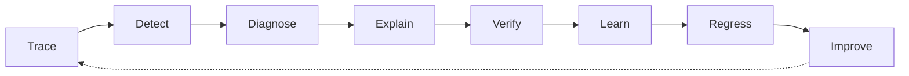

# Failure Forensics

**An AI reliability platform that finds where a bad AI answer first went wrong, shows how the error spread, and proves it with evidence.**

!!! info "Project at a glance"
    | Item | Detail |
    |---|---|
    | **Course** | CMPUT 401, University of Alberta, 2026–27 |
    | **Build window** | 2 Nov 2026 → 26 Feb 2027 (8 sprints) |
    | **Final demo** | First or second week of March 2027 |
    | **Team size** | 7 |
    | **Repository** | [UndergraduateArtificialIntelligenceClub/Failure-Forensics](https://github.com/UndergraduateArtificialIntelligenceClub/Failure-Forensics) |
    | **Backlog** | Jira project `KAN` · Confluence space `FF` |

## Client

The **Undergraduate Artificial Intelligence Club** at the University of Alberta, which owns the repository. The club wants a tool its members and partner teams can use to debug multi-step LLM applications (RAG pipelines, agents, document pipelines) and to teach how AI systems fail.

!!! note "To confirm with the client"
    The blueprint uses the abbreviation **UAIS** in its headers and mentions a decision model called **Jev**. Both are tracked as open questions in the [Glossary](requirements/glossary.md).

## The problem

Modern AI applications run many steps: rewrite the question, retrieve documents, rerank them, build a context, call a model, call tools. When the final answer is wrong, every step usually reports success. Logs show *that* something failed, not *where* it started or *why*.

Teams end up reading raw traces by hand, guessing at the cause, fixing one prompt, and having no way to check that the same failure does not come back.

## What we're building

A closed loop for AI failures:

1. A **Python SDK** that records every step of an AI pipeline as spans, including which step consumed which step's output.
2. A **backend** that stores traces and runs **detectors** (rules, statistics, a DecisionGate classifier and LLM judges).
3. A **forensics engine** that walks backward from the bad answer to the earliest step that degraded the data, and labels downstream steps as propagated.
4. An **evidence and grounding gate** so every claim in a diagnosis points at stored trace data.
5. A **human review** step that turns confirmed failures into **regression test cases**.
6. A **Next.js developer console** that shows the trace graph coloured by root cause, propagation and health.
7. **Benchmark apps** (document, RAG, agent) with controlled fault injection to measure root-cause accuracy.

## Who it's for

| User | What they need |
|---|---|
| AI / ML engineer | Find which step of an LLM, RAG or agent pipeline broke. |
| Backend engineer | Understand failures that cross APIs, tools, prompts and transforms. |
| Platform / DevOps engineer | Watch latency, cost, errors and worker health. |
| AI product team | Track quality, failure categories and release regressions. |
| Research / evaluation engineer | Build datasets, inject faults and measure diagnostic accuracy. |

## Stakeholders

| Stakeholder | Interest |
|---|---|
| Undergraduate AI Club (client) | A working, demo-able tool and clean hand-over. |
| CMPUT 401 instructor and TA | Process, sprint artifacts, final demo in early March. |
| Development team (7) | Shipping the MVP by 29 Jan and code-complete by 26 Feb. |
| Future maintainers | Clear docs, ADRs, tests and a reproducible local setup. |

## Team

| Role | Owner | Focus |
|---|---|---|
| Tech Lead & Architect | T1 | Scope, contracts, ADRs, integration, demo |
| SDK & Ingestion | T2 | Python SDK, span links, ingestion, compare view |
| Backend & Infrastructure | T3 | Database, APIs, jobs, security, CI/CD, staging |
| AI Detection | T4 | Taxonomy, validators, DecisionGate, LLM judges |
| AI Forensics | T5 | Root-cause engine, propagation, evidence, grounding |
| Frontend / UX | T6 | Developer console |
| Evaluation & Benchmarks | T7 | Benchmark apps, fault injection, eval runner, report |

Names are added on the [Roles](teamwork/roles.md) page once the team confirms them.

## Live app

The staging deployment goes live in **Sprint 7** (from 1 Feb 2027). Until then, see [Running Locally](running-locally.md).

## Documentation

- **[Project Requirements](requirements/executive-summary.md)**: scope, user stories, glossary, research
- **[Software Design](design/architecture.md)**: architecture, data model, sequence diagrams, wireframes
- **[Project Management](project-management/sprint-plans.md)**: the 8-sprint plan and story map
- **[Teamwork](teamwork/roles.md)**: roles, team canvas, sprint progress reports

